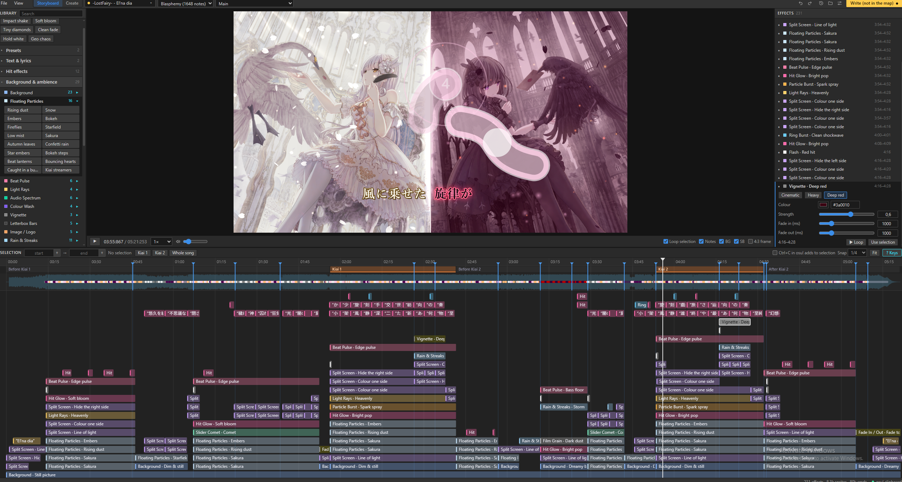
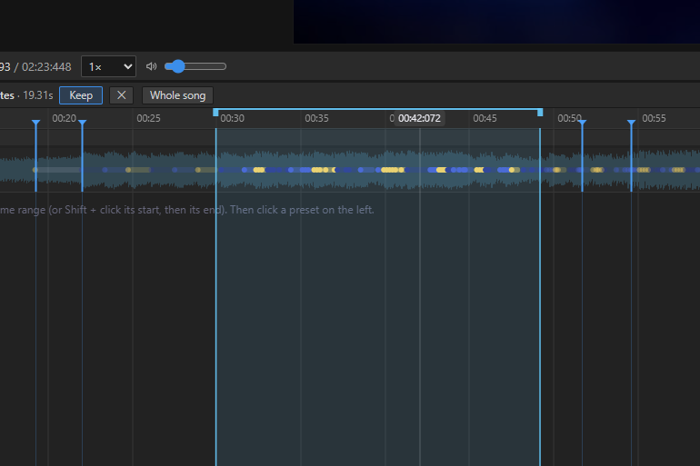
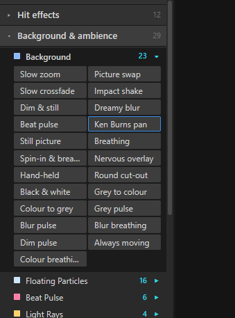
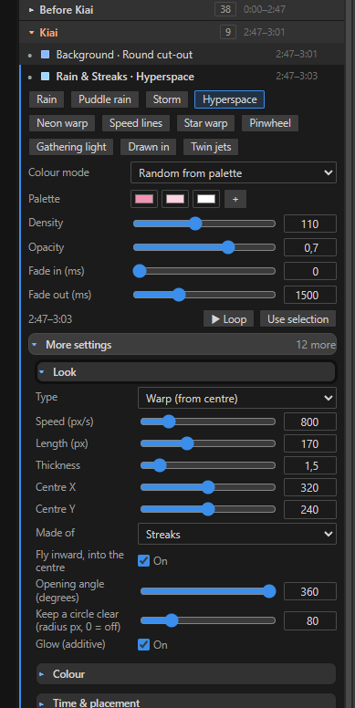
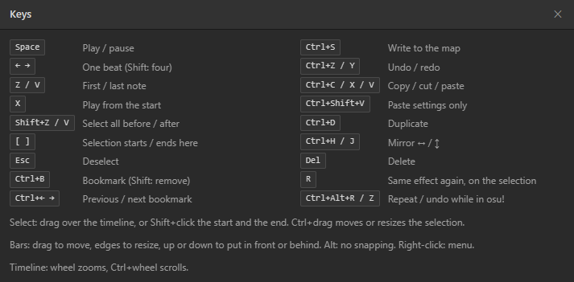

# Storyforge

It's a mapper's best friend for storyboarding! This is a tool specifically designed for mappers (or players) who have an interest in storyboarding but have not had the time or the resources to learn its ins and outs. While this program cannot create storyboards as detailed and complex as the most impressive Aspire maps you've ever seen, it has no knowledge requirements for getting started with storyboarding. Just start it up, pick a map and have fun!



## Download

### [Storyforge.zip](../../releases/latest/download/Storyforge.zip)

## What it does

The main idea of Storyforge is that you work with a timeline.

Objects you place show up on the timeline, for which vertical position indicates layer on the beatmap, i.e your lyrics belong at the top if they should be exempt from all filters or effects you put on, and the background that is affected by everything belongs at the bottom. You can move most elements vertically by just dragging them, but you cannot have a layer lower than the background layer.

## How to use it

To begin with, you would select an area to work on in the timeline, the effects you will add apply to everything in this layer, for this just click and drag across the timeline or shift+click to mark the start and the end of an area. Ctrl+c to save an area so you can revisit it later.

<p align="center"></p>

With an area selected you can add new effects here. Hovering over an effect shows a preview of this effect in action in the area you have selected, so if you don't have a concrete plan for your storyboard yet, you can windowshop here until you find a concept you like.

<p align="center"></p>

Every single effect is adjustable in the edit panel. Fine tune to your heart's content here.

<p align="center"></p>

Once you're happy with your masterpiece, hit ctrl+s or the "write" button at the top right, and your map will be saved to osu!. At this point if you're in the editor either ctrl+s ctrl+l or just exit out of the editor and reload, it should be there almost immediately. Happy storyboarding!

<p align="center"></p>

## Storyboards created during the testing phase

https://github.com/user-attachments/assets/4fca0e78-0e0b-4604-99a5-b01abf793be5

[Diplo, Sonny Fodera - Turn Back Time](https://osu.ppy.sh/beatmapsets/2569310#osu/5717169), map and storyboard by Kujinn

https://github.com/user-attachments/assets/385a5f84-d29e-440d-88fc-321d1db5e41c

[-LostFairy- - El'na dia](https://osu.ppy.sh/beatmapsets/2638306#osu/5945169), map by Booliix, storyboard by -Bin

https://github.com/user-attachments/assets/93847a8d-e0b3-482c-b883-7a4d8810a036

[POLKADOT STINGRAY - Benikurage](https://osu.ppy.sh/beatmapsets/1901997#osu/3921203), map by Lako, storyboard by -Bin

## Run from source

```
python server.py
```

## Credits

Massive shoutouts to

- [Lako](https://osu.ppy.sh/users/2906436)
- [Booliix](https://osu.ppy.sh/users/17516640)
- [Kujinn](https://osu.ppy.sh/users/3723568)
- [Sylian](https://osu.ppy.sh/users/2317990)
- [Kiinain](https://osu.ppy.sh/users/3780087)
- [Eyph](https://osu.ppy.sh/users/3881403)
- [Kiwisama](https://osu.ppy.sh/users/660311)

for their insightful feedback on the UI, features and bugs during the testing phase!

Storyforge was created by [-Bin](https://osu.ppy.sh/users/6573938), if you have any feedback or suggestions feel free to text me in game!

## Licence

MIT. osu! is a trademark of ppy Pty Ltd. Storyforge is a fan-made tool and is not affiliated with ppy.
